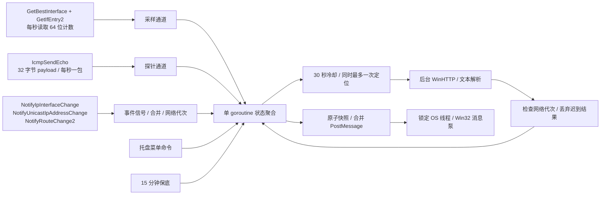

# 调度与资源设计

1. UI 线程只处理 Shell 通知、原子快照和原生菜单。不在这里等待 ICMP、HTTP、写设置或自启操作。
2. NIC 与心跳各一条工作协程，固定 1s 时钟。工作协程的发送通道同时选择 `ctx.Done()`，停机时不会卡在通道发送上。
3. `IcmpSendEcho` 使用系统 ICMP 句柄和复用缓冲区；650ms 超时保证正常调度下不会跨越下一个心跳周期。普通用户可使用，无 raw socket 提权。
4. 初始启动一次定位；接口 / 地址 / 路由变化、已确认断网后的恢复、用户刷新和 15 分钟周期可触发定位。首次成功及偶发一次丢包恢复不会额外查询。
5. 定位任务不重叠，所有触发共享 30s 起始间隔和 750ms 事件合并。网络事件递增代次，旧查询、旧探针、旧采样不得写回新网络状态。
6. WinHTTP 使用同步句柄，但只在后台运行，取消在有界系统调用之间检查。不会跨线程关闭正在使用的同步句柄；本地 API 超时与 8s 总请求上下文约束请求。单个系统调用可能略晚于上下文截止返回，UI 不受影响。
7. 退出先取消状态聚合与采样工作，再关闭 ICMP 句柄；网络通知注册使用 `CancelMibChangeNotify2` 同步注销。定位在后台检查取消，进程退出时系统释放剩余资源。
8. 图标采用固定 32×32 像素点阵；仅缓存当前国家的有限状态 / 流量 / 闪烁组合，切换国家释放旧 HICON，退出删除托盘并释放全部图标。

## 可验证的判定边界

- IO 计数衡量网卡真实累计流量，不能用接收 / 发送大于零来伪造公网连通性。
- 成功 Echo Reply 验证到所选目标的往返。超时只代表该目标没有成功回复，不声称已准确定位链路故障方向。
- IP 数据来源于低频 Cloudflare HTTPS；Geo 数据故障与连通性故障独立，国家未知时仍可呈现绿色网络状态。
- 公网地址改变但 Windows 不产生网络事件（例如路由器更换 NAT 出口）最晚依靠 15 分钟保底发现；不是所有公网 IP 变化都能秒级检测。
- Windows 通知区域不能附加任意外部文字，因此将两位代码绘进图标；Tooltip 和菜单给出完整文字。

## API 与依据

- [IcmpSendEcho](https://learn.microsoft.com/en-us/windows/win32/api/icmpapi/nf-icmpapi-icmpsendecho)
- [GetIfEntry2 / MIB_IF_ROW2](https://learn.microsoft.com/en-us/windows/win32/api/netioapi/ns-netioapi-mib_if_row2)
- [NotifyIpInterfaceChange](https://learn.microsoft.com/en-us/windows/win32/api/netioapi/nf-netioapi-notifyipinterfacechange)
- [NotifyUnicastIpAddressChange](https://learn.microsoft.com/en-us/windows/win32/api/netioapi/nf-netioapi-notifyunicastipaddresschange)
- [NotifyRouteChange2](https://learn.microsoft.com/en-us/windows/win32/api/netioapi/nf-netioapi-notifyroutechange2)
- [Shell_NotifyIconW](https://learn.microsoft.com/en-us/windows/win32/api/shellapi/nf-shellapi-shell_notifyiconw)
- [NOTIFYICONDATAW / NIF_SHOWTIP](https://learn.microsoft.com/en-us/windows/win32/api/shellapi/ns-shellapi-notifyicondataw)
- [WinHTTP 同步句柄关闭限制](https://learn.microsoft.com/en-us/windows/win32/api/winhttp/nf-winhttp-winhttpclosehandle)
- [Go GC 与内存软限制](https://go.dev/doc/gc-guide)
- [Windows 私有工作集统计](https://learn.microsoft.com/en-us/windows/win32/api/psapi/ns-psapi-process_memory_counters_ex2)
